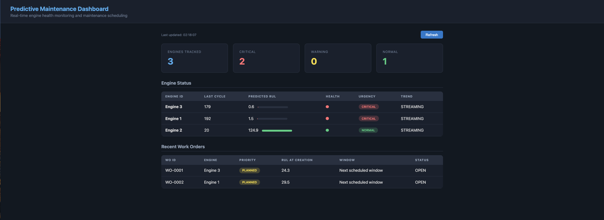

# Predictive Maintenance on Azure

An end-to-end predictive maintenance solution that predicts Remaining Useful Life (RUL) of industrial turbofan engines using Azure IoT Hub, Databricks, MLflow, and a real-time inference pipeline.



## Architecture

```
┌──────────────┐     ┌──────────────┐     ┌─────────────────┐
│   Simulated  │────▶│  Azure IoT   │────▶│  Azure Data     │
│   Sensors    │     │  Hub (F1)    │     │  Lake Gen2      │
└──────────────┘     └──────────────┘     └────────┬────────┘
                                                   │
                                          ┌────────▼────────┐
                                          │   Databricks     │
                                          │   (Serverless)   │
                                          │                  │
                                          │  • Feature Eng.  │
                                          │  • Model Training│
                                          │  • MLflow        │
                                          └────────┬────────┘
                                                   │
┌──────────────┐     ┌──────────────┐     ┌────────▼────────┐
│  Monitoring  │◀────│  Maintenance │◀────│  Inference API  │
│  Dashboard   │     │  Scheduler   │     │  (Flask)        │
└──────────────┘     └──────────────┘     └─────────────────┘
```

## Key Results

| Metric | Value |
|--------|-------|
| Best Model | Random Forest Regressor |
| Validation RMSE | 19.04 cycles |
| Validation MAE | 14.04 cycles |
| Validation R² | 0.7873 |
| Features Used | 42 (14 sensors × 3: raw + rolling mean + rolling std) |
| Top Feature | sensor_4_rolling_mean_5 (45.5% importance) |

## Dataset

**NASA C-MAPSS Turbofan Engine Degradation Simulation Dataset (FD001)**

- 100 engines running to failure
- 21 sensor measurements per operating cycle
- 3 operational settings
- 20,631 total observations
- Target: Remaining Useful Life (RUL), capped at 125 cycles

Source: [NASA Prognostics Data Repository](https://www.nasa.gov/content/prognostics-center-of-excellence-data-set-repository)

## Project Structure

```
predictive-maintenance-azure/
├── README.md
├── requirements.txt
├── .gitignore
├── data/
│   └── raw/                          # NASA C-MAPSS dataset (not committed)
├── simulator/
│   └── device_simulator.py           # IoT device simulator
├── notebooks/
│   ├── 01_setup_and_explore.py       # Databricks: data lake connectivity
│   ├── 02_feature_engineering.py     # Databricks: feature pipeline
│   └── 03_model_training.py          # Databricks: ML with MLflow
├── app/
│   ├── inference_api.py              # Flask REST API for predictions
│   ├── scheduler.py                  # Maintenance scheduling logic
│   ├── dashboard.py                  # Real-time monitoring dashboard
│   └── run_pipeline.py              # End-to-end pipeline orchestration
├── model_artifacts/
│   ├── rf_model.pkl                  # Trained Random Forest model
│   ├── scaler.pkl                    # StandardScaler for feature normalization
│   └── feature_cols.json             # Feature column definitions
├── infra/
│   └── setup.sh                      # Azure resource provisioning
└── docs/
    └── images/
        └── dashboard.png             # Dashboard screenshot
```

## Azure Services Used

| Service | Purpose | SKU/Tier |
|---------|---------|----------|
| **Azure IoT Hub** | Ingest real-time sensor telemetry | F1 (Free) |
| **Azure Data Lake Storage Gen2** | Store raw and processed data (medallion architecture) | Standard LRS |
| **Azure Databricks** | Feature engineering, model training with MLflow | Premium (Serverless) |
| **Azure Monitor** | Infrastructure monitoring | Included |

## Setup Instructions

### Prerequisites

- Azure subscription (Free/Student works)
- Python 3.9+
- Azure CLI (`az`) installed and authenticated

### 1. Provision Azure Resources

```bash
# Create resource group
az group create --name rg-predictive-maintenance --location northcentralus

# Create IoT Hub (Free tier)
az iot hub create \
  --resource-group rg-predictive-maintenance \
  --name iot-hub-pred-maint-<initials> \
  --sku F1 --partition-count 2

# Register a simulated device
az extension add --name azure-iot
az iot hub device-identity create \
  --hub-name iot-hub-pred-maint-<initials> \
  --device-id turbofan-engine-001

# Create Data Lake Storage
az storage account create \
  --name sadlpredmaint<initials> \
  --resource-group rg-predictive-maintenance \
  --location northcentralus \
  --sku Standard_LRS --kind StorageV2 --hns true

# Create storage containers
az storage container create --name raw-data --account-name sadlpredmaint<initials>
az storage container create --name processed-data --account-name sadlpredmaint<initials>
az storage container create --name ml-artifacts --account-name sadlpredmaint<initials>

# Set up IoT Hub routing to Data Lake
# (see infra/setup.sh for full routing commands)

# Create Databricks workspace
az databricks workspace create \
  --resource-group rg-predictive-maintenance \
  --name dbw-pred-maint-<initials> \
  --location northcentralus --sku premium
```

### 2. Download the Dataset

Download the NASA C-MAPSS FD001 dataset from [Kaggle](https://www.kaggle.com/datasets/behrad3d/nasa-cmaps) or the NASA repository. Place `train_FD001.txt` and `test_FD001.txt` in `data/raw/`.

### 3. Run the IoT Simulator

```bash
pip install -r requirements.txt

export IOTHUB_DEVICE_CONNECTION_STRING="<your-connection-string>"
python simulator/device_simulator.py --engine-id 1 --max-cycles 20
```

### 4. Train the Model (Databricks)

Upload `train_FD001.txt` to a Databricks Volume and run the notebooks in order:
1. `01_setup_and_explore.py` — verify data connectivity
2. `02_feature_engineering.py` — create features and save as Parquet
3. `03_model_training.py` — train models, compare, register best in MLflow

### 5. Run the Inference Pipeline

```bash
# Terminal 1: Start the inference API
python app/inference_api.py

# Terminal 2: Start the monitoring dashboard
python app/dashboard.py

# Terminal 3: Run the end-to-end pipeline
python app/run_pipeline.py

# Open http://localhost:5002 to view the dashboard
```

## Feature Engineering

### Sensors Dropped (Zero/Near-Zero Variance)
`sensor_1, sensor_5, sensor_6, sensor_10, sensor_16, sensor_18, sensor_19, op_setting_1, op_setting_2, op_setting_3`

### Features Created
For each of the 14 remaining sensors:
- **Raw value** — current sensor reading
- **Rolling mean (window=5)** — smoothed trend, captures gradual degradation
- **Rolling std (window=5)** — volatility, captures instability before failure

### Target Variable
- **RUL (Remaining Useful Life)** — cycles until engine failure
- Capped at 125 cycles (standard practice: early-life predictions above 125 are indistinguishable)

## Model Comparison

| Model | Train RMSE | Val RMSE | Val MAE | Val R² |
|-------|-----------|---------|---------|--------|
| Linear Regression | 21.06 | 20.88 | 16.98 | 0.7441 |
| **Random Forest** | **8.47** | **19.04** | **14.04** | **0.7873** |
| Gradient Boosting | 11.62 | 19.20 | 14.27 | 0.7837 |

**Selected model**: Random Forest — best validation RMSE and R².

### Known Limitations & Future Improvements
- **Overfitting gap**: Random Forest shows a train-val gap (8.47 vs 19.04). Mitigation: increase `min_samples_leaf`, reduce `max_depth`, or add more training engines.
- **Rolling features need continuity**: The model performs best with consecutive cycle data (as in real streaming). Sparse/batched inputs degrade prediction quality.
- **Single failure mode**: FD001 has one fault condition and one operating condition. Production systems would use FD002-FD004 (multiple fault modes) for robustness.
- **Azure ML deployment**: Model is served via Flask locally. For production, deploy as an Azure ML Managed Endpoint or Databricks Model Serving endpoint for auto-scaling and monitoring.

## Technologies & Skills Demonstrated

- **Cloud**: Azure IoT Hub, Azure Data Lake Gen2, Azure Databricks, Azure Monitor
- **Data Engineering**: IoT data ingestion, stream processing, medallion architecture (bronze/silver/gold)
- **Machine Learning**: Scikit-learn, feature engineering, model selection, MLflow experiment tracking & model registry
- **MLOps**: Model versioning, signature validation, artifact management
- **Software Engineering**: REST APIs (Flask), real-time inference, maintenance scheduling logic
- **Data Architecture**: Event-driven architecture, time-series partitioning, hierarchical data lake

## License

MIT
